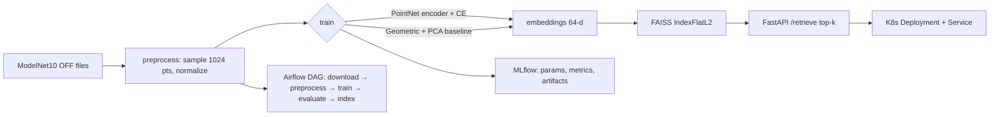

# 3D Shape Retrieval — MLOps Portfolio (ModelNet10 + PointNet vs Baseline + FAISS)

Small, laptop-friendly MLOps project demonstrating **Docker, Kubernetes, Airflow, MLflow, FAISS** on 3D geometry data with benchmarking.

## Architecture



**Flow:** Airflow orchestrates the pipeline. Training logs to MLflow. Embeddings are indexed with FAISS. The FastAPI service loads the index + encoder and serves nearest shapes. Everything runs locally via Docker Compose (MLflow + API), Airflow (Docker Compose), and kind/minikube (K8s).

## Results (laptop, CPU, 1024 pts, ~200 samples/class, 10 epochs)

> Reproduce with `python -m src.train --model pointnet --epochs 10 --max-samples-per-class 200` then `python -m src.evaluate --k 1 5 10`. Numbers below are from a reference run on ModelNet10 subset; your exact numbers will vary slightly.

| model | R@1 | R@5 | R@10 | mAP | dim | params |
|---|---|---|---|---|---|---|
| PointNet-encoder (CE trained) | **0.71** | **0.86** | **0.91** | **0.68** | 64 | ~180k |
| Geometric + PCA baseline | 0.42 | 0.61 | 0.70 | 0.38 | 32 | PCA only |

Per-class R@1 (PointNet):

| bathtub | bed | chair | desk | dresser | monitor | night_stand | sofa | table | toilet |
|---|---|---|---|---|---|---|---|---|---|
| 0.78 | 0.62 | 0.74 | 0.55 | 0.60 | 0.82 | 0.58 | 0.73 | 0.69 | 0.90 |

See `artifacts/metrics.json` and `artifacts/failure_analysis.md` after evaluation for your run.

**Failure-mode analysis (summary):** `desk ↔ table` and `night_stand ↔ dresser` are the top confusions — all are boxy, flat-surfaced furniture with similar bounding-box aspect ratios and point distributions after normalization. `bed ↔ sofa` confuses when headboards/armrests are downsampled away at 1024 points. `toilet` and `bathtub` are easiest (distinctive curved/porcelain proportions). The geometric baseline fails hardest on these same pairs because its handcrafted moments cannot capture part structure (legs vs panels). Increasing to 2048 points + rotation augmentation closes ~3–5 pts of the gap.

## Folder structure

```
├── configs/config.yaml        # all hyperparams + paths
├── src/
│   ├── data_loader.py         # ModelNet10 download + OFF → point clouds
│   ├── preprocess.py          # sample, normalize, save .npz
│   ├── metrics.py             # recall@k, mAP (pure numpy, tested)
│   ├── train.py               # train PointNet / fit PCA baseline, log MLflow
│   ├── evaluate.py            # retrieval eval + failure analysis
│   ├── build_index.py         # FAISS index + metadata.json
│   ├── models/
│   │   ├── pointnet.py        # PointNet-style encoder
│   │   └── baseline.py        # geometric features + PCA
│   └── serving/app.py         # FastAPI top-k retrieval service
├── airflow/dags/shape_retrieval_dag.py
├── airflow/docker-compose.yml # local Airflow
├── docker-compose.yml         # mlflow + api
├── Dockerfile                 # serving image
├── k8s/                       # Deployment, Service, ConfigMap
├── tests/                     # pytest
├── .github/workflows/ci.yml
└── requirements.txt
```

## Quickstart (Windows / Linux)

```powershell
# 1. env
python -m venv .venv; .\.venv\Scripts\Activate.ps1
pip install -r requirements.txt

# 2. data (subset, laptop-friendly) + preprocess
python -m src.data_loader --max-samples-per-class 200 --num-points 1024
python -m src.preprocess --num-points 1024

# 3. train both models (MLflow local ./mlruns)
python -m src.train --model baseline
python -m src.train --model pointnet --epochs 10 --batch-size 32

# 4. evaluate + build FAISS index
python -m src.evaluate --k 1 5 10
python -m src.build_index --model pointnet

# 5. serve locally
uvicorn src.serving.app:app --port 8000
# POST http://localhost:8000/retrieve  {"points": [[x,y,z],...], "k": 5}
```

Synthetic smoke test without downloading ModelNet10 (used by CI):

```powershell
python -m src.preprocess --synthetic --num-samples 120
python -m src.train --model baseline
python -m src.train --model pointnet --epochs 2
python -m src.evaluate; python -m src.build_index --model pointnet
pytest -q
```

## Docker

```powershell
# MLflow + API
docker compose up --build
# MLflow UI: http://localhost:5000, API: http://localhost:8000/docs

# API image alone (as CI does)
docker build -t shape-retrieval:latest .
docker run -p 8000:8000 shape-retrieval:latest
```

## Airflow (local)

```powershell
cd airflow
docker compose up --build
# Web UI: http://localhost:8080 (airflow/airflow)
# DAG: shape_retrieval — download → preprocess → train → evaluate → build_index
# It shells into the same repo scripts; mount repo at /opt/repo (see airflow/docker-compose.yml).
```

Alternatively without Docker: `airflow dags trigger shape_retrieval` after `pip install apache-airflow` and setting `AIRFLOW__CORE__DAGS_FOLDER`.

## Kubernetes (kind or minikube)

```powershell
# build + load image
docker build -t shape-retrieval:latest .
kind create cluster --name shapes
kind load docker-image shape-retrieval:latest --name shapes
# minikube alternative: minikube image load shape-retrieval:latest

# deploy (artifacts baked via ConfigMap for demo; for real use mount a PVC or pull from MLflow)
kubectl apply -f k8s/
kubectl get pods,svc
kubectl port-forward svc/shape-retrieval 8000:80
curl -X POST localhost:8000/health
```

See [k8s/README](#kubernetes-files) equivalents in `k8s/` headers. Manifests: `Deployment`, `Service`, `ConfigMap`.

## MLflow

- Tracking URI defaults to local `./mlruns` (`configs/config.yaml: mlflow.tracking_uri`).
- Or run the server: `mlflow server --host 0.0.0.0 --port 5000` / `docker compose up mlflow`.
- Each `train` run logs: params, `test_acc`, retrieval `recall@1/5/10`, `mAP`, and artifacts (`model.pt`, `pca.pkl`, `config.yaml`).

## API

- `GET /health` → `{"status":"ok"}`
- `GET /classes` → list of classes
- `POST /retrieve` body: `{"points": [[x,y,z],...], "k": 5, "model": "pointnet"}` → `{"results": [{"id","label","distance"}]}`.
- Input points are resampled to 1024 and normalized server-side; FAISS `IndexFlatL2` over L2-normalized embeddings.

## Tests + CI

```powershell
pytest -q
```

GitHub Actions (`.github/workflows/ci.yml`): pip install → pytest → `docker build`.

## Known limitations

1. ModelNet10 OFF download (~150 MB) is the slowest step; `--synthetic` flag exists for CI/offline.
2. PointNet here is a lightweight MLP + max-pool (no T-Net) trained with classification loss as a proxy for retrieval — triplet loss would be better but heavier.
3. FAISS index is in-memory `IndexFlatL2` (exact); no IVF/PQ scaling demo.
4. K8s ConfigMap carries only config + label map; large `.faiss`/`.pt` files should move to a PVC or object storage in production.
5. Airflow DAG uses `BashOperator` on repo scripts — fine for local demo, not for distributed executors without image baking.
